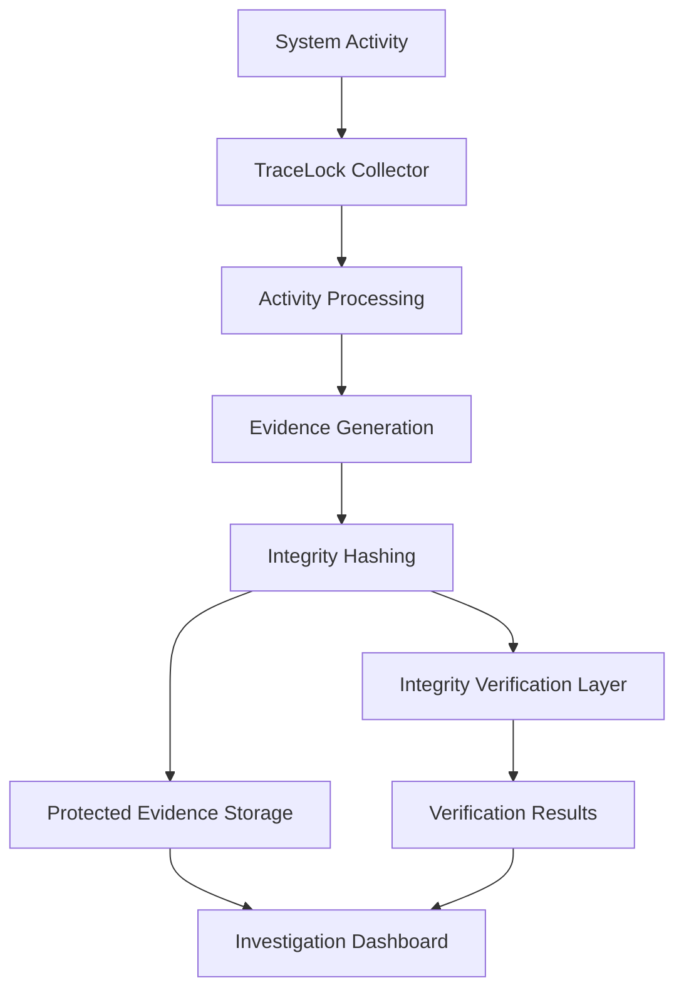
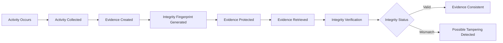

# TraceLock
### Evidence Integrity & Tamper-Evident System Activity Platform

> **TraceLock is a security-focused platform designed to capture, preserve, and protect critical system activity records—helping organizations maintain trustworthy digital evidence even when a system may be compromised.**

🌐 **Live Demo:** https://trace-lock.vercel.app

---

## 🛡️ Overview

TraceLock is a cybersecurity platform built around a critical security problem: **when a system gets compromised, the logs and evidence needed to investigate that compromise may also be compromised.**

Attackers can attempt to delete logs, modify records, hide their activities, or manipulate the evidence trail to avoid detection.

TraceLock aims to strengthen digital evidence integrity through structured activity collection, tamper-evident records, integrity verification, and a security-oriented evidence protection architecture.

Rather than simply storing system logs, TraceLock focuses on a more important question:

**Can we still trust the evidence after a system has been compromised?**

TraceLock is designed to make security records more difficult to manipulate silently and to help investigators reconstruct events with greater confidence.

---

## 🚨 Problem Statement

Traditional logging systems may face significant limitations during a security incident:

- Logs may be deleted or modified by an attacker.
- Evidence may be stored on the same compromised machine.
- Suspicious activities may be difficult to reconstruct.
- Investigators may not be able to determine whether records were altered.
- A compromised system may affect the integrity of its own security records.
- Organizations may lack a reliable, tamper-evident audit trail.

The challenge is not only detecting suspicious activity.

It is **preserving the credibility and integrity of the evidence used to investigate it.**

---

## 💡 Our Solution

TraceLock introduces a structured approach to system activity monitoring and evidence integrity.

The platform is designed around a workflow that collects relevant system activities, organizes them into security records, applies integrity protection mechanisms, and supports verification of whether stored evidence has been altered.

The objective is to establish a more trustworthy evidence trail that can support incident investigation, forensic analysis, and security accountability.

### Core concept

**Collect → Protect → Verify → Investigate**

---

## ⚙️ How TraceLock Works

### 1. System Activity

TraceLock begins with system activity that may be relevant to security investigations, including:

- Login and authentication events
- File access and modifications
- System-level changes
- Suspicious activities
- Security-relevant events

The objective is to create visibility into what happened, when it happened, and which activity requires further investigation.

### 2. TraceLock Collector

The Collector acts as the activity collection layer.

It is responsible for gathering relevant activity records and preparing them for the TraceLock evidence workflow.

This component is intended to reduce dependence on manually collected logs and establish a structured pipeline for security-related information.

### 3. Evidence Processing

Collected activity is organized into structured records for analysis and integrity protection.

Each record can be associated with relevant metadata, such as timestamps, event types, and record identifiers, depending on the implemented data model.

### 4. Integrity Protection

TraceLock incorporates integrity-focused mechanisms designed to make unauthorized modifications to recorded evidence detectable.

Integrity verification helps identify whether the evidence being examined remains consistent with its original recorded state.

### 5. Tamper Detection & Verification

When evidence is reviewed, integrity checks can be used to identify inconsistencies or modifications.

This is important because the presence of a log alone does not guarantee that the log is trustworthy.

### 6. Investigation & Analysis

The preserved activity records can support the investigation process by helping security teams understand the sequence of events, identify suspicious behavior, and examine the available evidence.

---

## 🔐 Core Features

### 📡 System Activity Monitoring
A structured approach to capturing security-relevant system activities and building visibility into events that may require investigation.

### 🧾 Evidence Collection
A dedicated collection workflow designed to gather activity records and organize them into usable evidence.

### 🛡️ Evidence Integrity
Integrity-focused mechanisms designed to help identify unauthorized modifications to evidence.

### 🔍 Tamper Detection
A verification-oriented approach to determining whether recorded evidence may have been altered.

### 🧠 Security Investigation
An investigation-focused workflow that helps organize records and understand the timeline of system activities.

### ⛓️ Blockchain-Assisted Integrity
Blockchain can serve as an additional trust layer for recording integrity proofs, hashes, or verification references.

Instead of placing sensitive logs directly on a blockchain, a privacy-conscious architecture can store evidence securely while using blockchain to anchor cryptographic proofs of integrity.

### 📊 Security Visibility
A centralized interface designed to make system activity, evidence status, and security-related information easier to understand.

---

## ⛓️ Why Blockchain in TraceLock?

Blockchain is not used as a replacement for a database or as a storage location for sensitive logs.

Its potential role is to provide an additional **tamper-evident trust layer**.

TraceLock can use cryptographic hashes of evidence records to generate integrity fingerprints.

These fingerprints can be anchored to an append-only or blockchain-based verification mechanism.

### Example workflow

1. A system activity record is collected.
2. A cryptographic hash is generated from the record.
3. The evidence is stored in the designated storage layer.
4. The hash or integrity proof is recorded in a trusted verification layer.
5. Later, the stored evidence is hashed again.
6. The new hash is compared with the original integrity proof.
7. A mismatch indicates that the evidence may have changed.

### Why this matters

If an attacker modifies the evidence after its integrity proof has been established, the resulting hash will differ.

This creates a way to identify potential evidence tampering.

> Blockchain helps establish evidence integrity—it does not automatically make a system secure or prevent every form of attack.

---

## 🏗️ System Architecture

TraceLock follows a modular security-oriented architecture.

### Architecture Components

| Component | Responsibility |
|---|---|
| System Activity | Generates security-relevant events |
| TraceLock Collector | Collects and forwards activity records |
| Activity Processing | Organizes and prepares collected records |
| Evidence Generation | Converts activity into structured evidence |
| Integrity Layer | Generates integrity proofs or cryptographic hashes |
| Evidence Storage | Stores collected evidence |
| Verification Layer | Checks integrity against established proofs |
| Dashboard | Presents records and verification information |

---

## 🔄 Evidence Lifecycle

---

## 🎯 What Makes TraceLock Different?

Traditional logging solutions primarily focus on:

**Recording what happened.**

TraceLock focuses on an additional layer:

**Preserving the trustworthiness of what was recorded.**

| Traditional Logging | TraceLock Approach |
|---|---|
| Focuses on log collection | Focuses on collection and evidence integrity |
| Logs may be vulnerable to modification | Introduces integrity-verification mechanisms |
| Evidence trust may depend on the compromised system | Designed around stronger evidence trust boundaries |
| Investigation relies on available records | Emphasizes structured, verifiable evidence |
| Detecting an incident is the primary focus | Detection, preservation, and verification are part of the vision |

TraceLock is not intended to replace existing security monitoring solutions. It explores how evidence integrity and tamper-evident security records can complement them.

---

## 🧰 Technology Stack

> Update this section to match the exact technologies implemented in your repository.

| Layer | Technology |
|---|---|
| Frontend | React / Next.js |
| UI & Styling | Tailwind CSS |
| Deployment | Vercel |
| Security Architecture | Evidence integrity & tamper detection |
| Cryptographic Concepts | Hashing and integrity verification |
| Trust Layer | Blockchain-assisted integrity verification |
| Backend & Storage | Project implementation dependent |

---

## 🖥️ Platform

Explore TraceLock:

**Live Application:**  
https://trace-lock.vercel.app

TraceLock is currently being developed as a prototype to demonstrate the concept of security activity collection, evidence integrity, and tamper-evident verification.

---

## 🎓 Built For

TraceLock explores the intersection of:

- Cybersecurity
- Digital forensics
- System monitoring
- Evidence integrity
- Blockchain technology
- Cryptographic verification
- Security engineering

It was developed as an innovation-driven project to explore how digital evidence can become more trustworthy, verifiable, and resistant to manipulation.

---

**TraceLock — Evidence Integrity & Tamper-Evident System Activity Platform**

